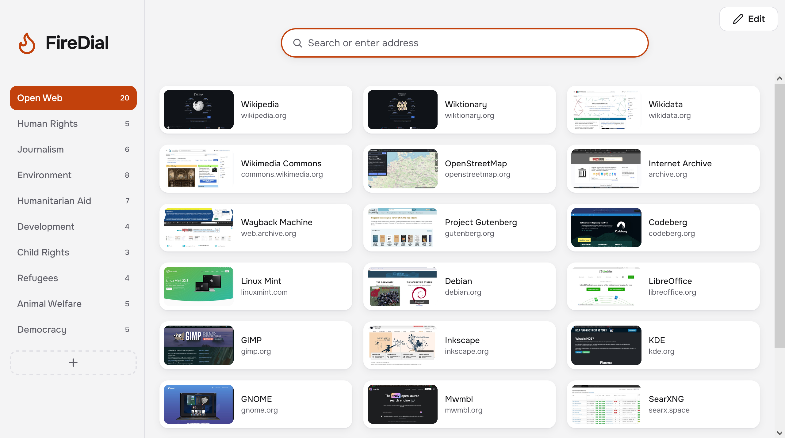
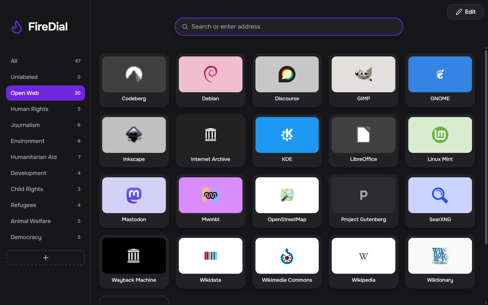
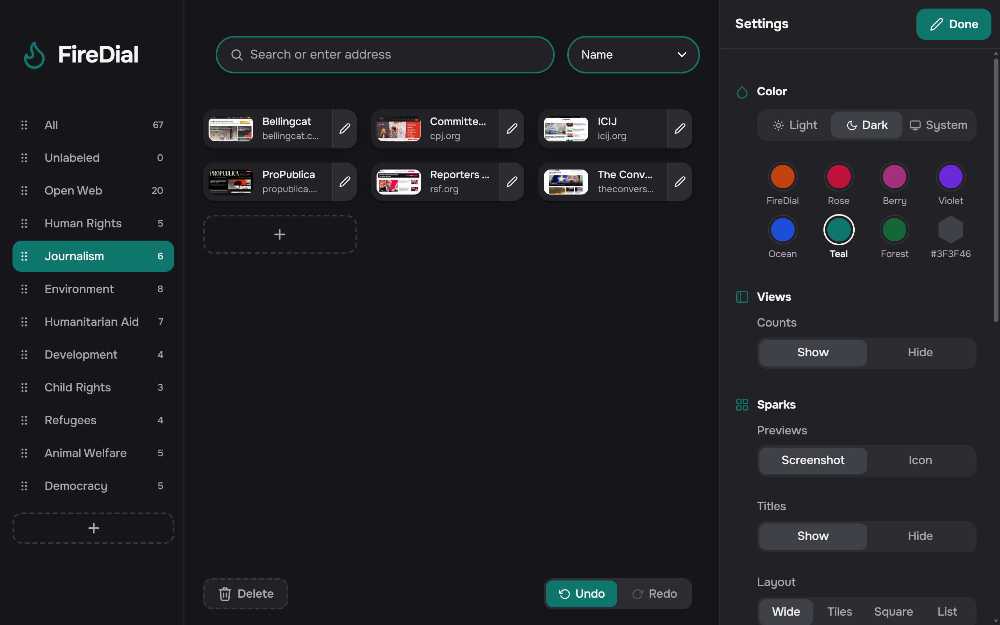
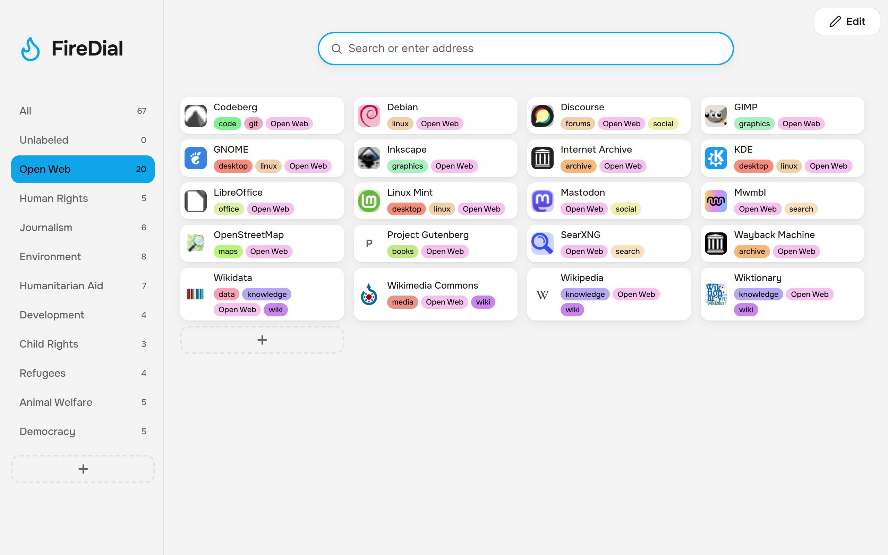

# FireDial

Minimal speed dial for your bookmarks in Firefox and Chrome! Completely free and open source: no ads, no account, no tracking, no BS.



<p>
  
  
  
</p>

## Install

- Chrome: https://chromewebstore.google.com/detail/khflkpkeicdbceieebokdclnedonmphk
- Firefox: https://addons.mozilla.org/firefox/addon/firedial

## Usage

- Right-click a page or link: **Add to FireDial**.
- **Edit**: settings. **About**: shortcuts, bookmark import.
- Views show sparks by label, e.g. _Work or News_, _all but Private_.
- **Sync** keeps all browsers the same, through your own Google Drive.
- Or just your browser's sync: sparks are bookmarks (**Other Bookmarks → FireDial**), previews stay local.

## Build

```bash
git clone https://github.com/sebastianstucke87/FireDial.git
cd FireDial
npm ci
npm run build
```

The builds are in `dist/chrome` and `dist/firefox`. `npm test` runs the checks and the tests in headless Chrome and Firefox.

To load your build in Chrome:

1. Open `chrome://extensions`
2. Turn on `Developer mode`
3. Click `Load unpacked` and pick `dist/chrome`

To load it until Firefox restarts:

1. Open `about:debugging#/runtime/this-firefox`
2. Click `Load Temporary Add-on...`
3. Pick `dist/firefox/manifest.json`

## Trust

- FireDial collects no data: [privacy policy](https://firedial.org/privacy.html). Sync is optional and goes to your own Google Drive.
- FireDial is not for sale.
- FireDial is published at:
  - Website: [firedial.org](https://firedial.org/)
  - GitHub: [github.com/sebastianstucke87/FireDial](https://github.com/sebastianstucke87/FireDial)
  - Google, Chrome Web Store: [chromewebstore.google.com/detail/khflkpkeicdbceieebokdclnedonmphk](https://chromewebstore.google.com/detail/khflkpkeicdbceieebokdclnedonmphk)
  - Mozilla, Firefox Add-ons: [addons.mozilla.org/firefox/addon/firedial](https://addons.mozilla.org/firefox/addon/firedial)

  Anything else claiming to be FireDial is fake; report it to the organization that hosts it.

- Contact: [Open an issue](https://github.com/sebastianstucke87/FireDial/issues) or [report a vulnerability](https://github.com/sebastianstucke87/FireDial/security/advisories/new).
