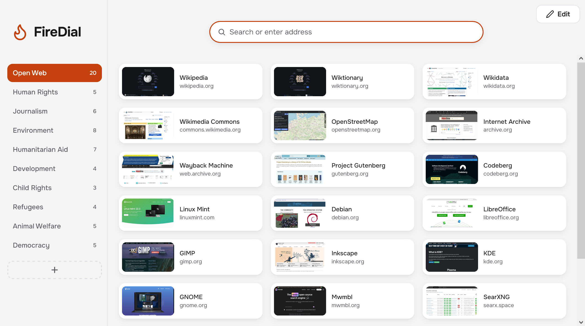
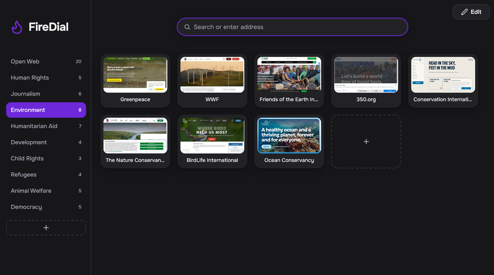
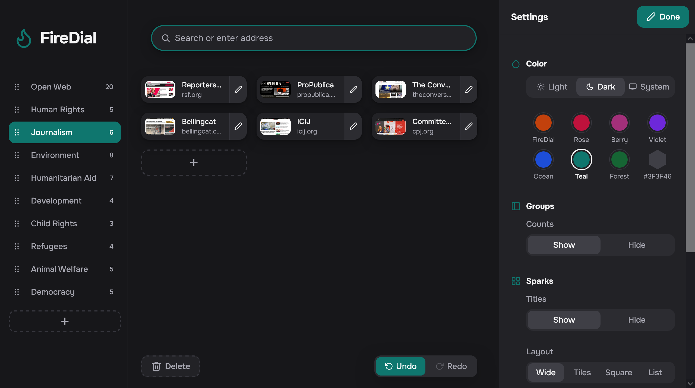
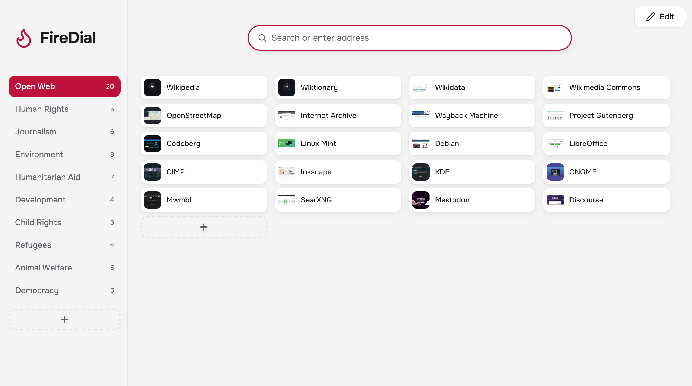

# FireDial

Minimal speed dial for your bookmarks in Firefox! Completely free and open source: no ads, no account, no tracking, no BS.



<p>
  
  
  
</p>

## Build

Needs Node 26.

```bash
git clone https://github.com/sebastianstucke87/firedial.git
cd firedial
npm ci
npm run build
```

The add-on is in `dist/firefox`. `npm test` runs the checks and the tests in headless Firefox.

## Install

From addons.mozilla.org: https://addons.mozilla.org/firefox/addon/firedial/

Or from your build, until Firefox restarts:

1. Open `about:debugging#/runtime/this-firefox`
2. Click `Load Temporary Add-on...`
3. Pick `dist/firefox/manifest.json`

## Usage

- Right-click any page, link or tab: **Add to FireDial**.
- **Edit** (top right) holds all settings; **About** lists the keyboard shortcuts.
- Sparks are bookmarks in **Other Bookmarks → FireDial**, so Firefox Sync carries them. Images stay on this device.

## Trust

- FireDial is only published at github.com/sebastianstucke87/firedial and addons.mozilla.org/firefox/addon/firedial. Anything else claiming to be FireDial is fake: please report it.
- FireDial is not for sale.
- Something odd? [Open an issue](https://github.com/sebastianstucke87/firedial/issues), or for security problems [report a vulnerability](https://github.com/sebastianstucke87/firedial/security/advisories/new) privately.
